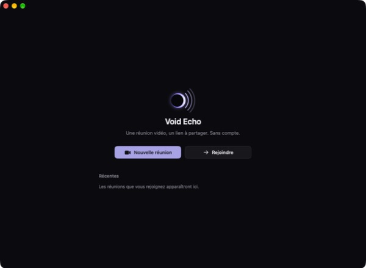
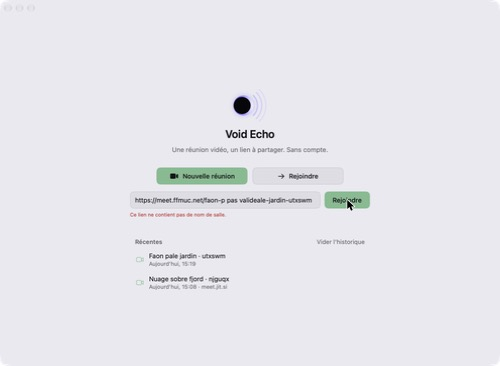
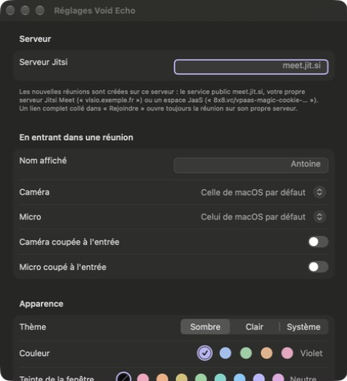
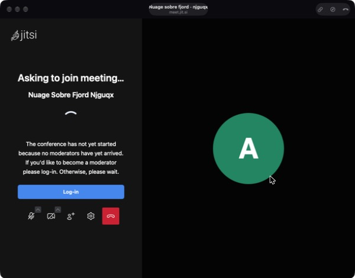
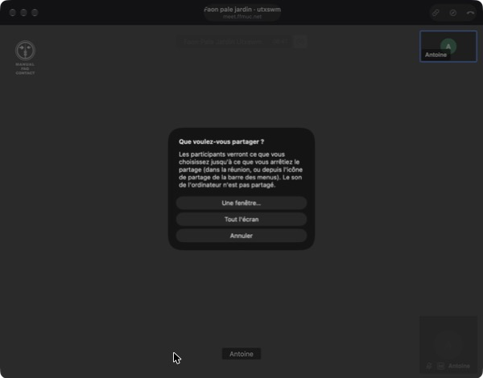

# Void Echo

**Une réunion vidéo, un lien à partager. Sans compte.** Version **0.1** (préversion). Void Echo est l'app de visioconférence de la suite Void, aux côtés de [Void](https://github.com/antocrne/Void), Void Calendar et Void Notes. Elle en reprend la palette pastel, le cadre neutre ou teinté, le thème sombre par défaut, et le même parti pris : rien de superflu à l'écran. L'accueil tient en deux boutons et une liste.

La vidéo et le son sont assurés par **Jitsi Meet**. Void Echo ne réimplémente rien de WebRTC : la réunion est la page web de Jitsi affichée dans une `WKWebView`. Void Echo s'occupe de tout ce qui l'entoure : créer une salle, la partager, rejoindre un lien, préparer caméra et micro, l'historique et les réglages.

- Swift + SwiftUI (AppKit pour la fenêtre et quelques détails), WebKit, AVFoundation
- Apple silicon, macOS 14 minimum
- **≈ 2 Mo** (build Release : 1,9 Mo), **aucune dépendance externe**
- Serveur par défaut `meet.jit.si`, modifiable dans les réglages (serveur auto-hébergé, JaaS…)



| | |
|---|---|
|  |  |
|  |  |

## Compiler et lancer

Prérequis : Xcode 16 ou plus récent (projet au format « dossiers synchronisés », comme le reste de la suite ; testé avec Xcode 27), un Mac Apple silicon.

**Avec Xcode** : ouvrir `VoidEcho.xcodeproj`, choisir le schéma *VoidEcho* → *My Mac*, puis ⌘R.

**En ligne de commande** :

```bash
xcodebuild -project VoidEcho.xcodeproj -scheme VoidEcho -configuration Release -derivedDataPath build/DerivedData build
```

```bash
open "build/DerivedData/Build/Products/Release/Void Echo.app"
```

Pour l'installer dans `/Applications`, ou mettre à jour la copie qui s'y trouve :

```bash
./scripts/install.sh
```

Comme pour Void Calendar, chaque build du schéma *VoidEcho* copie aussi l'app dans `/Applications` (post-action du schéma, `scripts/copy-to-applications.sh`, compte rendu dans `build/copy-to-applications.log`). Pour s'en passer : Product → Scheme → Edit Scheme… → Build → Post-actions.

La signature est ad hoc (« Sign to Run Locally »), sans compte développeur. macOS associe les autorisations caméra et micro à la signature, qui change à chaque compilation : **après une recompilation, macOS peut redemander l'accès** à la caméra et au micro. Renseigner une équipe dans *Signing & Capabilities* règle le problème.

L'icône est générée par script (`swift scripts/make-icon.swift`, aperçu avec `--preview fichier.png`) : l'éclipse de Void, éclairée par la droite, et trois arcs qui s'en éloignent en s'estompant, l'écho. L'ensemble (éclipse et arcs) est centré sur l'icône. Le logo de l'accueil (`EchoLogo`, dans `Theme.swift`) est le même dessin.

## Comment Void Echo s'appuie sur Jitsi

Une réunion, c'est une salle sur un serveur Jitsi Meet : `https://<serveur>/<nom-de-la-salle>`. Void Echo charge cette adresse dans une `WKWebView`, c'est-à-dire l'application web de Jitsi telle que le serveur la sert. Les appels, la vidéo, le chat, les réactions, la liste des participants, les réglages de Jitsi : tout cela vient de Jitsi, inchangé. Void Echo n'ajoute que :

1. **Des paramètres dans le lien**, dans la forme que Jitsi lit au chargement (`#config.…`, `#userInfo.displayName=…`) : la page de pré-connexion de Jitsi est désactivée (Void Echo a la sienne), le nom choisi est transmis, ainsi que l'état voulu du micro et de la caméra. Tous ces paramètres font partie de ceux qu'un lien a le droit de modifier (liste blanche de Jitsi).
2. **Deux petits scripts** injectés dans la page (`Meeting/MeetingScripts.swift`) :
   - *Choix des périphériques* : WebKit ne laisse pas une app choisir la caméra ou le micro d'une page. Le script remplace le choix mémorisé par Jitsi par les noms choisis dans Void Echo, et oriente vers ces appareils les demandes de la page qui n'en précisent aucun. Un changement d'appareil fait ensuite dans les réglages de Jitsi, pendant la réunion, est respecté.
   - *Pont avec Jitsi* : il lit l'état de la réunion dans l'objet `APP` de Jitsi (salle rejointe, micro et caméra allumés ou non, partage d'écran) et donne au menu les commandes ⌘D, ⌘E et ⌘W, par les mêmes fonctions que la barre d'outils de Jitsi.
3. **Les réponses aux questions de WebKit** (`Meeting/MeetingSession.swift`) : caméra et micro (accordés au seul serveur de la réunion, et seulement si macOS les accorde à Void Echo), partage d'écran (voir plus bas), notifications et localisation (refusées), fenêtres ouvertes par la page (dans une petite fenêtre de Void Echo : c'est par là que passe la connexion des modérateurs de meet.jit.si), liens externes (navigateur par défaut).
4. **La navigation** : quand Jitsi quitte la salle de lui-même (bouton raccrocher, fin de réunion), sa page d'accueil n'est pas affichée : Void Echo revient à son propre accueil.

**Pourquoi Jitsi entre « sans média », et comment Void Echo le gère.** Vérifié dans le code de Jitsi et en test : quand un lien désactive la page de pré-connexion de Jitsi hors d'une iframe, Jitsi entre dans la salle **sans ouvrir ni caméra ni micro** (`disableInitialGUM`), une protection contre les liens qui allumeraient une caméra à l'insu de l'utilisateur. Le choix ayant été fait sur l'écran de pré-connexion de Void Echo, le pont allume, une fois la salle rejointe, le micro et la caméra laissés actifs sur cet écran.

**À savoir** : `APP` est l'objet interne de l'application web Jitsi, utilisé par sa propre barre d'outils, mais ce n'est pas une API publique garantie. S'il venait à changer sur un serveur, la réunion fonctionne toujours (tout passe par l'interface de Jitsi) ; seuls ⌘D / ⌘E basculent alors sur la coupure du micro et de la caméra par WebKit, et l'allumage automatique à l'entrée ne se fait plus (il suffit de cliquer sur le micro ou la caméra dans Jitsi). L'iframe API officielle (`external_api.js`) n'est pas utilisée : sur meet.jit.si, une réunion intégrée en iframe est coupée après 5 minutes.

## Changer de serveur

**Réglages → Serveur Jitsi.** Le champ accepte :

- `meet.jit.si` (par défaut, champ vide) ;
- un serveur auto-hébergé : `visio.exemple.fr`, `https://visio.exemple.fr:8443` ;
- un serveur qui sert ses salles sous un chemin, comme JaaS : `8x8.vc/vpaas-magic-cookie-…`.

L'adresse est toujours utilisée en HTTPS (les pages non sécurisées n'ont pas accès à la caméra). Le serveur s'applique aux **nouvelles réunions** et aux **noms de salle tapés seuls** dans « Rejoindre ». Un **lien complet** collé dans « Rejoindre » ouvre toujours la réunion sur son propre serveur, quel que soit le réglage ; l'historique garde le serveur de chaque réunion. Une adresse illisible est signalée sous le champ, et les réunions restent alors sur meet.jit.si.

Dans le code, l'adresse par défaut n'est écrite qu'à **un seul endroit** : `JitsiServer.defaultAddress` (`VoidEcho/Jitsi/JitsiServer.swift`).

JaaS : les salles JaaS demandent en général un jeton (JWT) émis par votre backend ; Void Echo n'en gère pas en 0.1. Le lien d'une salle JaaS accessible sans jeton fonctionne comme les autres.

## Caméra, micro et autorisations

- `NSCameraUsageDescription` et `NSMicrophoneUsageDescription` dans `Config/Info.plist`, avec des textes qui disent à quoi servent la caméra et le micro.
- Entitlements (`Config/VoidEcho.entitlements`) : App Sandbox, réseau sortant (`network.client`), caméra (`device.camera`), micro (`device.audio-input`). Rien d'autre : pas de fichiers, pas de réseau entrant. Le partage d'écran ne demande pas d'entitlement.
- macOS pose la question **une fois, sur l'écran de pré-connexion** (et non au milieu de la réunion).
- Si l'accès est refusé dans Réglages Système, l'écran de pré-connexion le dit (« Void Echo n'a pas accès à la caméra. ») avec un bouton **Ouvrir Réglages Système** qui ouvre directement le bon panneau (Confidentialité et sécurité → Caméra ou Micro). Dans la réunion, une bannière fait de même si la page demande un appareil refusé. Le réglage *Autorisations* de Void Echo montre l'état des deux accès.
- La page ne reste jamais sans réponse : WebKit reçoit toujours « accordé » ou « refusé ». Toute autre origine que le serveur de la réunion (fenêtres ouvertes par la page, par exemple) est refusée.
- Notifications et localisation demandées par la page : refusées.

## Partage d'écran (testé)

**Il fonctionne, dans la fenêtre de Void Echo, avec le bouton de partage de Jitsi**, sur macOS 27.0.1. WebKit ne propose le partage d'écran à une app que par une méthode privée de son délégué (`_webView:requestDisplayCapturePermissionForOrigin:…`, la même que Void utilise) ; sans elle, WebKit refuse tout partage.

Ce que le test a montré, honnêtement :

- Répondre « écran » à WebKit (`1`) **partage tout de suite l'écran entier, sans choix**. C'est ce qui s'est passé au premier essai (l'écran a été partagé une quarantaine de secondes, dans une salle de test sans autre participant, avant d'être arrêté).
- Void Echo demande donc d'abord, dans une feuille claire : **« Une fenêtre… »**, **« Tout l'écran »** ou **« Annuler »**. « Une fenêtre… » ouvre le sélecteur de macOS (« Share a Window », survol puis « Share This Window », ou Annuler / Échap). « Tout l'écran » partage l'écran sans autre question ; l'icône de partage de la barre des menus permet ensuite d'en changer ou d'arrêter.
- Testé : la feuille, le partage de tout l'écran (piste reçue par Jitsi, indicateur de macOS dans la barre des menus), son arrêt (l'indicateur disparaît), le sélecteur de fenêtre de macOS et son annulation. **Non testé** jusqu'au bout : la sélection effective d'une fenêtre dans ce sélecteur, et l'arrêt par le bouton de Jitsi (l'outil de test n'a pas le droit de cliquer dans l'interface système) ; c'est dans la checklist.
- Le **son** de l'ordinateur n'est pas partagé (WebKit ne capture que l'image ; Void le fait par ScreenCaptureKit, pas Void Echo en 0.1).

Si une version de macOS ou de WebKit ne donnait pas `getDisplayMedia` à la page, Void Echo l'indique : un bouton « Partage d'écran indisponible ici » apparaît dans la barre de titre de la réunion et explique comment **continuer la réunion dans le navigateur** (Void Echo quitte la salle et le navigateur par défaut la rouvre, pour ne pas y être deux fois). Ce même bouton (icône boussole) est toujours disponible dans la barre de titre, pour le son partagé ou tout autre besoin du navigateur.

## Conditions de meet.jit.si (testé)

Constaté le 13 octobre 2026 : **une salle de meet.jit.si ne démarre qu'avec un modérateur connecté.** Le premier arrivant voit « Asking to join meeting… The conference has not yet started because no moderators have yet arrived. If you'd like to become a moderator please log-in. Otherwise, please wait. » Aucun appareil n'est ouvert tant que la salle n'a pas démarré.

- Le bouton **Log-in** ouvre une petite fenêtre de Void Echo avec « Sign in with Google » et « Sign in with GitHub ». (Au premier essai, Jitsi affichait « Login popup was blocked by your browser » : la fenêtre est ouverte après une requête réseau, quand WebKit ne compte plus le clic. Corrigé : la page du serveur de la réunion peut ouvrir des fenêtres, qui restent dans Void Echo.)
- **Non testé** : la connexion elle-même (elle demande votre compte Google ou GitHub). Google refuse parfois de se connecter dans une vue web intégrée ; si c'est le cas, GitHub, ou « Continuer dans le navigateur », restent possibles.
- Une fois un modérateur présent, les invités entrent normalement.

C'est l'une des raisons pour lesquelles le serveur est réglable. Pour les tests, le serveur public `meet.ffmuc.net` (Freifunk München) n'a pas demandé de connexion : création, entrée, caméra, micro, raccourcis, partage d'écran et départ y ont été vérifiés, avec un second participant dans un navigateur.

## Utilisation

- **Nouvelle réunion** (⌘N) : un nom de salle aléatoire, lisible et difficile à deviner, trois mots et un suffixe (`faon-pale-jardin-utxswm` : 128 × 128 × 128 mots × 31⁶ suffixes, ≈ 50 bits tirés du générateur sûr du système, sans caractères ambigus ni accents). L'écran de pré-connexion propose **Copier le lien** en un clic.
- **Rejoindre** (⌘J) : un lien complet, un lien sans `https://`, ou un nom de salle seul. Un lien de réunion déjà copié est proposé tout de suite.
- **Pré-connexion** : nom affiché, caméra et micro (aperçu de la caméra, niveau du micro), boutons pour les couper avant d'entrer. Les valeurs par défaut viennent des réglages ; les choix faits ici valent pour cette réunion.
- **Dans la réunion** : Jitsi occupe toute la fenêtre sous la barre de titre (dessinée par l'app comme dans Void, sans les capsules « Liquid Glass » de la barre d'outils système), qui montre la salle et trois boutons (copier le lien, continuer dans le navigateur, quitter). ⌘D coupe ou réactive le micro, ⌘E la caméra, ⌘W quitte la réunion (et revient à l'accueil, la fenêtre reste ouverte). Le menu **Réunion** reprend ces commandes et indique l'état actuel (« Couper le micro » / « Réactiver le micro »). Quitter Void Echo (⌘Q) pendant une réunion la quitte proprement d'abord.
- **Historique** : les réunions rejointes, la plus récente en haut (nom, date, serveur s'il diffère du réglage). Survol : copier le lien, Rejoindre ; double-clic : rejoindre ; clic droit : retirer de l'historique. **Vider l'historique** demande confirmation.
- **Une seule réunion à la fois** : « Nouvelle réunion » et « Rejoindre » sont indisponibles pendant une réunion.

## Où sont les données

```
~/Library/Containers/app.void.echo/Data/Library/Application Support/Void Echo/history.json
```

L'historique (salle, serveur, date), au maximum 50 réunions, rien d'autre. Les réglages sont dans les préférences du conteneur (`app.void.echo`), avec les mêmes clés que le reste de la suite pour le thème, l'accent et la teinte. Les données de site de Jitsi (ses propres réglages) sont dans le stockage WebKit du conteneur. Aucun compte, aucun serveur à Void Echo : la seule chose qui sort du Mac, c'est la réunion elle-même, vers le serveur Jitsi choisi.

## Structure du projet

```
VoidEcho/
  App/        VoidEchoApp, AppDelegate (raccourcis ⌘D ⌘E ⌘W, sortie propre), AppModel (écran courant,
              réunion unique), AppSettings, EchoCommands (menus), Theme et ChromeTint (repris de la
              suite), AppKitBridges
  Jitsi/      JitsiServer : serveur, salles, lecture des liens, générateur de noms
  Home/       MainWindowView, HomeView (deux boutons, champ Rejoindre)
  History/    HistoryStore (JSON), RecentMeetings (liste)
  Prejoin/    PrejoinView, PreviewSession (aperçu caméra, niveau micro), MediaAccess (autorisations,
              appareils)
  Meeting/    MeetingSession (WKWebView et délégués), MeetingScripts (scripts injectés), MeetingView,
              PopupWindowController, DebugProbe (Debug seulement)
  Settings/   SettingsView
Config/       Info.plist, VoidEcho.entitlements
scripts/      make-icon.swift, install.sh, copy-to-applications.sh
docs/         ETAT-V0.1.md (fait / partiel / non fait), CHECKLIST-TEST.md, screenshots/
```

**Sonde de test (Debug seulement)** : un script écrit dans `~/Library/Containers/app.void.echo/Data/tmp/probe.js` (corps de fonction async, `return …`) est exécuté dans la page de la réunion, et son résultat écrit dans `probe.out` à côté ; `probe.log` trace les demandes de caméra, micro et partage d'écran. C'est ainsi que l'état réel de Jitsi a été vérifié pendant les tests. Absente des builds Release.

## Limites connues

- **meet.jit.si** exige un modérateur connecté (Google ou GitHub) pour démarrer une salle ; connexion non testée (voir plus haut).
- **Partage d'écran** : sans le son de l'ordinateur ; « Tout l'écran » partage l'écran sans sélecteur (Void Echo prévient avant).
- Le pont avec Jitsi repose sur l'objet interne `APP` (voir plus haut).
- Choix de la caméra et du micro : par le nom de l'appareil, que WebKit et macOS donnent identique pour les appareils testés (FaceTime HD Camera, micro Bluetooth, micro du MacBook Pro). Un appareil au nom différent côté WebKit retomberait sur l'appareil par défaut.
- Signature ad hoc : macOS peut redemander caméra et micro après chaque recompilation.
- Pas de JWT (JaaS, serveurs à jeton), pas de comptes, pas d'enregistrement, pas de planification, pas de réunions parallèles : hors du périmètre de la 0.1.
- Interface en français uniquement, comme le reste de la suite.

Le détail de ce qui est fait, partiel ou non fait est dans [docs/ETAT-V0.1.md](docs/ETAT-V0.1.md), la checklist de test manuel dans [docs/CHECKLIST-TEST.md](docs/CHECKLIST-TEST.md).
